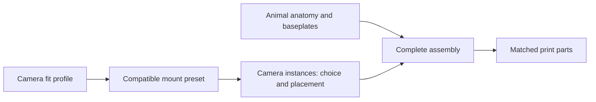

# Eye tracker

**Preferred Pupil Labs eye camera:** [selected complete R08 module](shared/cameras/pupil-core-eye/README.md), including the notched lens, optical axis and flush TPU ribbon. Use it for new camera geometry; historical species checkpoints remain pinned.

Start with the **mouse monocular assembly**. It reproduces the Mouse Hats R10
high-water mark using the shared hardware library. The selected checkpoint is
`ET-MOUSE-RAISED-TARGET-R19`, with the raised anatomical baseplate and re-aimed camera. Historical R01/R10 reconstruction inputs remain available.

Run `review.FCMacro` in the existing desktop FreeCAD session to open the selected
mouse, the R10 reference and the exploded shared-hardware view together.

## What lives where

| Location | What it means |
| --- | --- |
| [shared/cameras/](shared/cameras/) | Camera fit profiles. Today: the inherited Pupil Core PCB envelope. |
| [shared/mounts/](shared/mounts/) | Printed hardware that fits a camera: tray/support regions, holder, cap and clip. Today: the R10 mount preset. |
| [mouse/assembly.json](mouse/assembly.json) | The mouse recipe: one eye-camera instance, its camera/mount choice, placement and baseplate. |
| [mouse/anatomy.json](mouse/anatomy.json) | Mouse skull/eyes, baseplate geometry and inherited anatomical target. |
| [mouse/checkpoints/](mouse/checkpoints/) | Saved complete assemblies for opening, comparing and exporting. |
| [rat](rat/README.md) | Monocular rat: supplied skull/mandible with unchanged shared mouse hardware; scale, mounting and aim remain provisional. |
| [marmoset](marmoset/README.md) | CT skull source and separate simplified print derivative; no complete assembly selected. |
| [human](human/README.md) | Reserved species folder; no anatomy or assembly has been supplied yet. |

## The four useful terms

- **Camera profile:** the hardware being accommodated. The current profile is an
  approximate PCB fit envelope, not a complete manufacturer camera model.
- **Mount preset:** a compatible set of printed geometry and its internal camera
  arrangement. R10 preserves the accepted tray, ribbon route, socket and holder pose.
- **Camera instance:** one use of a camera and mount, with a unique name, an
  `eye` or `world` role, and a position/rotation in the animal assembly.
- **Complete assembly:** anatomy, baseplates and all camera instances together.
  Its selected checkpoint determines the matched parts to export.

Camera count is the length of the recipe's camera list. Species and camera model
are separate choices. A future rat recipe can reuse the same hardware twice;
a different camera needs its own fit profile and a compatible mount preset.

## Where we are now

The shared builder loads small extracted geometry assets and composes the mouse.
It does not load the old complete R09/R10 assembly to construct the new one.
R10 is opened separately for comparison. The carrier is fused from its tray/mount
region and its support/socket region; those are regions of one printed part.

Tests cover equivalence to R10, unchanged anatomy/sightline, matched-part exports,
and two independently placed camera instances. The two-camera test is a spatial
fixture, not a rat design or physical-fit validation.

## Rat: monocular first

The first [Monocular rat](rat/README.md) checkpoint uses the supplied rat skull
and mandible with the same shared hardware as the mouse. Its registration and
eye-region target are provisional, and the scan's units need confirmation.
Open `rat/open.FCMacro` in the existing FreeCAD window to inspect it.

Next, confirm the anatomy and use the forthcoming camera sketches to replace
the approximate PCB profile with measured camera geometry. Then revise the arms
and sensor aim for the rat. A separate binocular variant will follow, with
back-to-back PCBs and two eye cameras around a revised central holder.

Rigid rotation/translation is implemented. Mirroring hardware, automatically
aiming sensors, redesigning support curves and proving ribbon clearance are
separate geometry work. Preserve the physical camera's handedness when deciding
whether a printed mount should be mirrored.

[Mouse build and review](mouse/README.md) · [Shared library details](shared/README.md) ·
[Preserved Mouse Hats exploration](../mouse-hats/INDEX.md)
