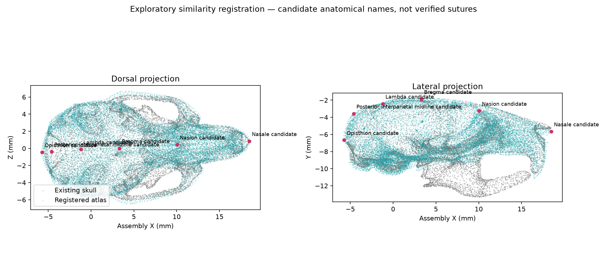

# Mouse skull landmark study R01

This bounded proof of concept imports a published segmented mouse skull and its
45 landmark coordinates into FreeCAD, then transfers them to a preserved copy
of our existing skull by a proper similarity transform. It does not replace the
active skull or select a new complete assembly.

Open `open.FCMacro` through the existing-window procedure in
`docs/development.md`. The ivory skull is our existing model; magenta points
are transferred estimates. Each point has an ID, name status, source coordinates
and surface-distance property. Enable **Atlas comparison** to inspect the cyan
registered atlas overlay. Labels appear in the model tree; select a point to
read its properties. The native file is under `checkpoints/`.

## What this establishes

The published template combines CT skull anatomy from 8-week-old females across
25 inbred strains and five F1 crosses. It provides segmented cranium and
landmarks, but is not a median adult male specimen. Source methods also warn
that automatic landmark transfer can systematically differ from manual labels
[@maga2017MouseSkullAtlas]. This study uses that resource as an anatomical
reference and a workflow demonstration, not evidence to rescale our animal.

The pinned repository supplies a 35.278 micrometre segmentation, label 1 for
skull, and a 45-point LPS/mm Markups file. The author data and GPL-3.0 license
are preserved in `sources/`; hashes and URLs are in `sources.json`
[@magaMouseCTAtlasRepository]. No upstream scripts were executed.

The original model descends from the supplied low-poly skull, subsequently
repaired to 84,560 triangles. Its biological specimen and original scan metadata
are unresolved. The current source is hash-verified through `anatomy.json` and
the selected ET-MOUSE-MONO-R01 checkpoint. The historical repair lineage is in
`designs/mouse-hats/skull-placement/README.md`.

## Registration result and limitations

The atlas is reduced from 3,552,316 to 30,000 triangles for CAD display.
NIfTI RAS coordinates are converted explicitly to landmark LPS. A visually
initialized, 85%-trimmed nearest-point ICP estimates rotation, translation and
uniform scale (1.07344); reflection and nonrigid deformation are excluded.
The complete 4x4 transform is in `validation.json`.

Independent seeded surface samples give atlas-to-existing median disagreement
0.207 mm and 95th percentile 1.147 mm. Reverse-direction values are 0.114 mm
and 2.841 mm. The existing skull includes mandible geometry absent from this
atlas skull segment; its filled interior also differs from the hollow CT
anatomy. These residuals measure surface disagreement, **not landmark target
registration error**. No independent target landmark measurements exist.

Six source IDs have tentative anatomical interpretations: nasale, nasion,
bregma, lambda, posterior interparietal midline and opisthion. Those names are
visual hypotheses, not verified mappings from the author's definition chart.
All 45 original IDs remain intact. Points stay at their transformed coordinates;
nearest-surface coordinates are recorded separately, not silently substituted.
The remaining IDs have no asserted anatomical names.

The atlas derivative is not watertight and FreeCAD reports mesh defects. It is
an inspection/reference mesh, not a print-ready solid. No hardware, eye pose,
interface, or physical-fit validation is claimed. Existing skull geometry is
preserved; registration does not recover missing sutures or individual bones.

## Rebuild and validation

Use the repository root as the working directory. Install the study-local reader
with `uv pip install nibabel==5.4.2 --no-deps --target generated/eye-tracker/mouse/skull-landmarks-study-r01/python-deps`.
The CAD tooling environment already supplies NumPy, SciPy, scikit-image,
trimesh, fast-simplification and matplotlib.

1. Run `register.py` with `tools/cad/.venv/Scripts/python.exe`. It verifies source
   checkpoints and pinned atlas hashes, writes derived STL files under
   `generated/`, and updates the study's transform and landmark records.
2. Run `build.py` with the pinned FreeCAD bundled Python. It builds the isolated
   native model and reopens it to verify 45 point coordinates and the preserved
   skull facet count. Output/checkpoint paths belong only to this study.
3. Use `open.FCMacro` for desktop review. Its styles do not alter anatomy.
   `native-validation.json` records the saved native hash and checks.

The optional `render_hidden.py` sets review styles in an isolated GUI process;
its offscreen screenshot was blank, so no screenshot is offered as visual proof.
The inspected `registration-review.png` is generated directly from mesh vertices.

## Next bounded milestone

Verify the ID-to-name dictionary against the author's supplementary definitions,
then inspect bregma, lambda, nasion and bilateral orbital/zygomatic features on
the CT template. Separate the existing mandible and fit corresponding cranium
surfaces only. Hold out several manually confirmed points to measure transfer
error. Only then consider a locally deformable map or transferring individual
bone regions. Keep the original skull and transform lineage available alongside
any replacement. STL must travel with the JSON sidecar: it cannot encode these
named landmarks or their uncertainty itself.

Digimouse remains useful for matched soft tissue, while the Henderson surgical
atlas is another CT/MRI route. Neither is needed for this skull-only prototype.
The present milestone intentionally stops short of an exhaustive atlas.
