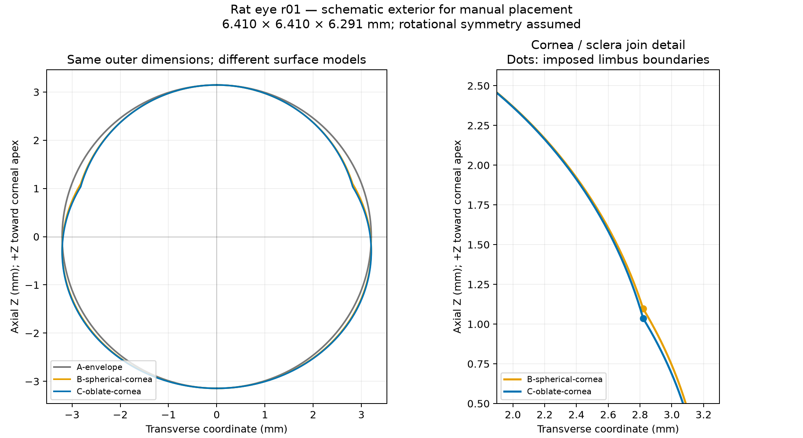

# Schematic rat eyes

**Current review: [R02 material regions and reference frames](r02/README.md).**
R02 provides an independent rat-eye model plus right/left instances in the skull,
with separate cornea/sclera colors and right-handed XYZ guides centered on the
complete-envelope volume centroid. The sections below preserve the R01 geometry
and placement history; their axial-midpoint origin applies to R01 only.

## First-pass skull placement

Open [rat-skull-eyes-placement-r01.FCStd](rat-skull-eyes-placement-r01.FCStd)
for the separate placement study. Both C eyes are individually editable mesh
objects. Select an eye and edit **Data > Placement**, or use **Transform** from
its context menu. Save your adjusted document as a new revision to retain this
starting point.

The centers are `(13, -8.8, +8.5)` and `(13, -8.8, -8.5)` mm in the registered
rat frame. Corneal axes point mostly laterally, slightly rostrally and dorsally:
approximately 71 degrees outward from +X and 14 degrees above the XZ plane.
These are visual placement choices, not literature-derived gaze measurements.
The origin represents the mesh's outer axial midpoint, not a measured rotation
center. Symmetry is assumed despite asymmetry in the scan.

The first pass was inspected from lateral, dorsal, rostral and oblique views.
Eyes were raised 1.2 mm and moved medially 0.5 mm from the earlier provisional
orbital markers to improve their visual position above the cheek arches.
No automated bone-clearance or soft-tissue fit is claimed. Skull triangles and
eye scale are unchanged; the selected camera assembly is unchanged.

`placement-r01.json` records the transforms. Run `place-r01.FCMacro` in FreeCAD
to rebuild a separate document into `generated/eye-tracker/rat/eye-placement-r01/`.
The source skull retains scienceminer's supplied CC BY-SA attribution and license
(version unspecified); see `../skull/provenance.json` and its original license.

## Shape alternatives

Start with **C-oblate-cornea** for manual placement on the skull. All three STLs
have the same 6.410 × 6.410 × 6.291 mm exterior bounds and coordinate frame.
These are solid exterior envelopes; they contain no pupil, lens, retinal shell,
optic nerve or eyelids. A corneal surface is not a pupil surface.

| STL in `stl/` | Construction | Use and tradeoff |
| --- | --- | --- |
| `rat-eye-r01-A-envelope.stl` | One slightly oblate spheroid | Simplest size/clearance reference; no distinct corneal surface. |
| `rat-eye-r01-B-spherical-cornea.stl` | Oblate body plus spherical corneal cap | Simple explicit cornea; resulting sag is 2.049 mm rather than the reported 2.110 mm. |
| `rat-eye-r01-C-oblate-cornea.stl` | Oblate body plus slightly oblate corneal cap | Matches the chosen width, length, corneal base, sag and apical curvature constraints; more assumptions about how those measurements form a surface. |



## Evidence and interpretation

Hughes studied D.A. rats aged 115–130 days. Table 1 reports eye length 6.29 mm,
nasotemporal width 6.41 mm, corneal height 2.11 mm, corneal base radius 2.82 mm,
and posterior scleral curvature radius 3.23 mm. Table 2 puts the anterior cornea
at zero, retinal surface at 5.981 mm, outer limiting membrane at 6.111 mm, and
outer posterior sclera at 6.291 mm; its anterior corneal radius is 2.965 mm.
We use the outer endpoint for this exterior mesh. These are cohort means and
rounded schematic parameters, not micrometre-level biological tolerances
[@hughes1979RatEye].

For context, Lozano and Twa report a 6.91 ± 0.44 mm **cornea-to-retina** length
and 3.39 mm corneal curvature radius in older male Brown Norway rats. Those
values illustrate cohort and endpoint differences; they are not substituted
into this external envelope [@lozanoTwa2013RatEye]. We need the intended animal's
strain/age or a measured reference before treating any nominal size as its fit.

### Explicit CAD assumptions

We repeat the measured nasotemporal width in the other transverse direction to
make a surface of revolution. We interpret corneal base radius as a circular
limbus radius, corneal height as sag above that plane, and the reported corneal
radius as apical curvature. Those interpretations and the posterior spheroid
closure are our construction choices. This is not the complete Hughes optical
model or a digitization of his anatomical drawing.

The cap and body meet exactly but retain a slope change at the limbus. We have
not added a smoothing fillet with unsupported dimensions. Posterior curvature
is a useful check on the compromise: the derived body radius at the posterior
pole is about 3.572 mm for B and 3.624 mm for C; neither matches the reported
3.23 mm. A is approximately 3.266 mm there but lacks the distinct cornea.
Changing that closure would be a further model choice, not mesh refinement.

The existing mouse meshes were fitted by
[`inspect_cornea.py`](../../../../mouse-hats/skull-print/inspect_cornea.py) as
two oblate spheroids: body semiaxes 1.50/1.50/1.26 mm and corneal semiaxes
0.75/0.75/0.63 mm. See the
[mouse print record](../../../../mouse-hats/skull-print/README.md).
C reuses the two-spheroid idea, with independently defined rat dimensions.
The mouse triangles, placements and fitted dimensions remain unchanged.

## Coordinates and manual placement

Import STL coordinates as **millimetres at 100% scale**; STL has no unit metadata.
The origin is the midpoint of the outer axial endpoints. It is not a measured
eye rotation center. The corneal apex is `(0, 0, +3.1455)` and the posterior
pole is `(0, 0, -3.1455)`. **+Z points outward through the cornea.** X and Y are
equivalent transverse directions. This symmetry axis is not a calibrated visual
axis or a camera calibration model.

1. Import one STL into a working copy of the rat document.
2. Rotate +Z to the intended outward eye direction, then translate into the orbit.
3. Preserve that placement when swapping A/B/C to compare the shape assumptions.
4. Save the positioned eyes in a new document/revision and record their transforms.

The selected rat R01 checkpoint and its provisional target are unchanged. These
files make no skull-registration or physical-fit claim. Aim review should use
the visible anterior eye region; this model alone does not locate the pupil
plane or account for its refracted appearance.

## Exact construction

Let `L` be external axial length, `a` half the transverse diameter, `r` the
limbus radius, `R` corneal apical curvature radius, and `h` corneal sag.
The apex and back are `+L/2` and `-L/2`.

- A: `rho²/a² + z²/(L/2)² = 1`, where `rho² = x² + y²`.
- B: corneal semiaxes `ac = bc = R`; derive `h = R - sqrt(R²-r²)`.
- C: set the reported `h`; derive `bc = R*h²/(2*R*h-r²)` and
  `ac = sqrt(R*bc)`. Thus apical curvature `ac²/bc = R`.
- B/C body: `q = sqrt(1-(r/a)²)`, axial semiaxis `b = (L-h)/(1+q)`,
  center `zs = -L/2+b`. Retain its posterior portion through `z = L/2-h`.
- B/C cap: center `zc = L/2-bc`; retain the anterior portion of
  `rho²/ac² + (z-zc)²/bc² = 1` above that same joining plane.

Each exterior is revolved and triangulated directly, including an exact shared
limbus ring. There are no overlapping solids or internal closing faces in the
STL. `parameters.json` is the input record; `validation.json` includes derived
semiaxes, centers, volumes and hashes.

## Rebuild and verify

From the repository root after [toolchain setup](../../../../../docs/development.md):

```powershell
& tools/cad/.venv/Scripts/python.exe designs/eye-tracker/rat/references/eyes/build.py
```

This writes STLs, `comparison.png` and a validation report into ignored
`generated/eye-tracker/rat/eyes-r01/`. The checked-in `stl/` files are the retained
r01 review artifacts, stored with Git LFS. Rebuilds do not overwrite them.
Create a new revision when changing parameters or construction.

Validation reloads the serialized STLs and checks one closed connected body,
consistent outward winding, Euler characteristic 2, nondegenerate triangles,
expected bounds and agreement with analytically integrated volume within 0.1%.
The positive, monotone axial profiles establish a non-self-intersecting surface
of revolution. The r01 volume discrepancy is below 0.026%. These checks establish
mesh quality; anatomical accuracy and skull placement remain separate judgments.

Run `review.FCMacro` in the existing FreeCAD session for a separate comparison
document. The three review objects are spaced along X; those display translations
are not baked into the STL files. Its axial guide lines are separate objects.
