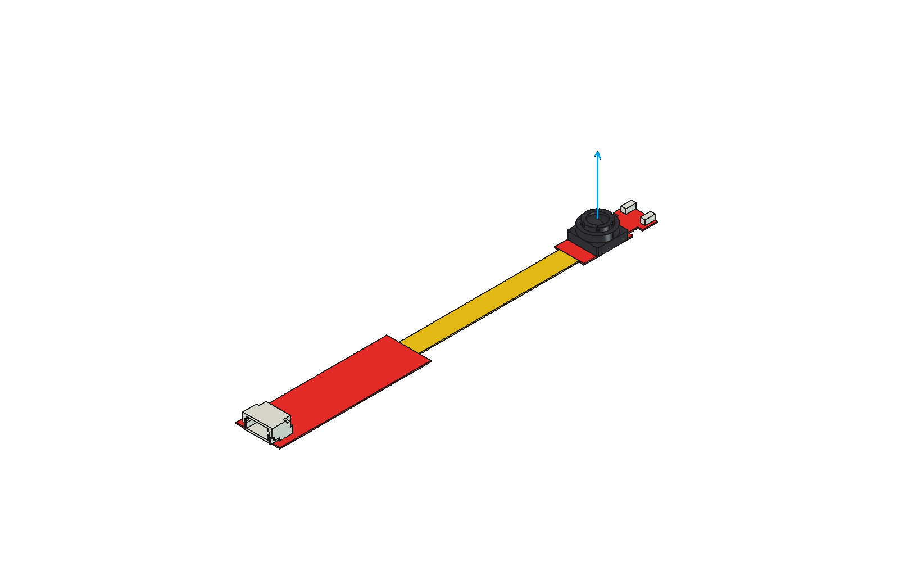

# Preferred Pupil Labs eye-camera model

**Selected checkpoint: CAMERA-DUMMY-R08.** Use [active-model.json](active-model.json)
for new Pupil Labs Core eye-camera geometry and mock-ups. The complete module
includes both PCBs, the flat ribbon, JST connector, LEDs, the notched straight
lens barrel and the optical axis. The user selected this geometry on 2026-10-14.



## Open or reuse

The native model, STEP and four-material U1 project are preserved in
[checkpoints/CAMERA-DUMMY-R08](checkpoints/CAMERA-DUMMY-R08/). Each selected asset
has a SHA-256 hash in the manifest. Git LFS stores the CAD files; hydrate LFS
assets after cloning. No generated output is needed to load this selection.

For desktop review, send `open.FCMacro` to the existing FreeCAD window using
[the development workflow](../../../../../docs/development.md). The macro
verifies the selected checkpoint before opening it.

For new assembly code, add `designs/eye-tracker/` to `sys.path` and run in
FreeCAD Python:

```python
from shared.camera import add_camera
camera = add_camera(document, name='EyeCamera', placement=placement)
```

`placement` is a FreeCAD Placement mapping the saved print frame into the
assembly frame. The returned App::Part contains all four material regions and
its optical datum. Move that group as a unit. Use `camera.PhysicalParts` for
physical exports; `camera.OpticalAxis` and `camera.SensorFrame` are references.
The axis vector properties are local coordinates; apply the group placement
to obtain world positions and its rotation to obtain world directions.

The substrate occupies Z=0 through 0.25 mm. Both ribbon faces are flush with
the PCB faces. +Z points outward through the lens. SensorCenter is the
hypothetical sensor on the PCB top; Origin is the lens bounding-box center.
The manifest contains their exact coordinates. Preserve this frame explicitly
when bending the ribbon or adapting a species assembly.

## Materials and evidence

| Region | U1 tool | Material |
| --- | --- | --- |
| PCBs | 1 | Red PLA |
| Lens and holder | 2 | Black PLA |
| Connector and LEDs | 3 | White PLA |
| Ribbon | 4 | Yellow TPU |

R08 uses measured plan geometry, a 6.3 mm square holder, a 3.7 mm barrel top
above the mounting base and six rim notches. The 0.25 mm substrate thickness,
barrel details and fake optical surface are mock-up choices. The holder derives
from the supplied drawing reconstruction [@iadiyM5HolderDrawing]; see
[lens reconstruction evidence](lens-m5-r01/README.md). It is not manufacturer
CAD or a functional threaded optical assembly. The sensor datum is hypothetical,
not calibrated. Geometry checks establish solid validity, flat interfaces and
exclusive material regions; physical fit, stiffness and slicing remain unverified.

## Selection and history

`active-model.json` is authoritative; a higher revision directory is not an
implicit selection. `camera.json` points here, and `../defaults.json` selects
this camera for new shared work. The old `pcb_envelope` fields remain historical
fit data in their original frame. New geometry uses `shared.camera.add_camera`.

Existing mouse and rat checkpoints, mount compatibility and historical build
recipes remain pinned to their original geometry. Adapting them to this camera
requires a new complete assembly revision and interface/targeting validation.
No compatibility with an existing mount is asserted by this camera selection.

Keep `study-r01` through `study-r03`, `lens-m5-r01` through `lens-m5-r05`, and
`dummy-print-r01` through `dummy-print-r08` as lineage. The checkpoint directory
contains the build validation reports and `lineage.json`. R08's build reads its
frozen lens input, so it does not depend on earlier generated lens outputs.

Validate the selected assets and reusable import from the repository root:

```powershell
.cad-tools/FreeCAD_1.1.4-Windows-x86_64-py311/bin/python.exe tools/cad/validate_camera.py
```

Success prints `SELECTED_CAMERA_OK` and writes a report under
`generated/verification/camera/`. Create future revisions beside this checkpoint;
select a replacement only after geometry and interface review.
